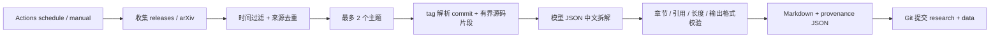

# 架构与扩展边界

首版采用可预测的单进程 pipeline，而不是让模型自由访问网络和写仓库。

## 可信边界

- GitHub/API 原始资料只作为数据，不接受其中的指令。
- 模型只能生成内容，不能决定写入路径、修改 workflow、持有 GitHub 写工具或执行命令。
- 外部请求不接受带凭证的 URL；模型端点要求 HTTPS，不跟随重定向。
- 模型 API key 只在请求头出现；不写日志、不写 query、不写日报。
- 外部源码不执行，只读取小型文本片段；上游代码许可保持不变。
- 生成的标题/正文不允许带外部链接、HTML、代码围栏；引用由可信程序从证据表生成。
- 结构校验不等于事实验证。引用可能支持不足、源码启发式选取可能错过变更点，需人工复核。

## 可重试与幂等

- 来源 URL 稳定哈希是选题去重键；full 成功才消耗，collect 不消耗。
- 当天已有 full 日报直接跳过；collect 可升级为 full。
- 所有选题分析成功后才落盘，避免模型调用中途失败提交半篇研究。
- GitHub Actions concurrency 串行化定时与手动运行。
- 只提交 research/data，不提交运行时环境和 Secrets。推送冲突仅 rebase，冲突失败不强推。

## 当前实现不做什么

- 不追踪整个 GitHub 或所有新仓库，不做全网新闻索引。
- 不自动阅读论文 PDF 全文，也不推断论文实现细节。
- 不自动执行复现实验，不给出已经验证的性能结论。
- 不保证 07:15 准点，GitHub schedule 可能延迟或停用。
- 不依赖当前豆包会话或个人电脑常驻进程。
- 不将公开 HTTP/模型可达性检查伪装成完整端到端成功。

## 后续演进方向

1. 提供 topic/schema 版本，支持每天 1 篇主研究 + 若干轻量雷达。
2. 按 release 提及的 PR/commit diff 选择精确源码，而非文件路径关键字。
3. 增加官方博客/RSS、论文全文与显式新仓库发现适配器。
4. 引入人工审查 PR 模式，在公开传播前做事实与来源核验。
5. 独立无密钥沙箱执行可复现实验，增加运行日志与结果附件。
6. 供应商侧成本限额 + 可选模型适配层 + 更细的错误分类。

这些是扩展建议，不是首版已经实现的功能。
